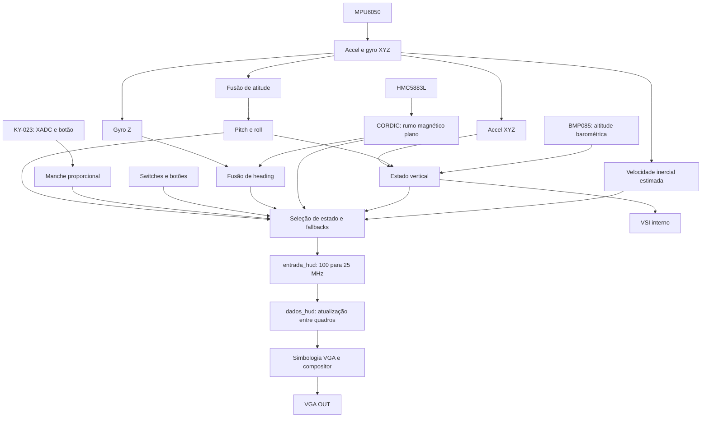

# Trabalho Display Avião / HUD FPGA

Projeto acadêmico de **Sistemas Digitais**: um HUD aeronáutico gerado em
SystemVerilog na **Digilent Nexys A7-100T**, com Artix-7 XC7A100T-CSG324-1.
A FPGA desenha o HUD em VGA 640×480 e combina sensores de movimento, pressão e
campo magnético com controles manuais. Ferramentas: **Vivado 2026.1** e
**Icarus Verilog**.

Esta documentação descreve a fusão validada em `84411c3`, isolada na branch
`dev/fusao-sensores`. A base `main` permanece em `de80521`. A branch de
organização documental deriva da fusão e **não a promove à main**.
A fusão nova está **PENDENTE DE VALIDAÇÃO FÍSICA**.

## Funcionalidades

### Vídeo e HUD

- VGA com 4 bits por cor, clock de pixel de 25 MHz e aproximadamente 59,52 Hz.
- Retículo fixo, horizonte, pitch ladder e representação de roll.
- Heading com N/E/S/W, escalas e números de velocidade e altitude.
- Alvo gráfico fixo, sem rastreamento ou target lock.
- Modos NORMAL/DECLUTTER e estilos ORIGINAL/CAÇA.
- Geração por coordenadas, sem framebuffer ou entrada de vídeo externo.

### Hardware e sensores

| Componente | Função | Interface |
| --- | --- | --- |
| Nexys A7-100T | Processamento e VGA OUT | Clock de 100 MHz; saída VGA onboard |
| MPU6050 / GY-521 | Aceleração XYZ e gyro XYZ | I²C independente |
| BMP085 | Pressão/temperatura e altitude barométrica | I²C independente |
| HMC5883L | Referência magnética XYZ | I²C independente |
| KY-023 | Manche proporcional e botão SENSOR/MANCHE | XADC e entrada digital |

As ligações completas, tensões e GPIOs de expansão estão em
[pinagem](docs/pinagem.md). Não aplicar RGB analógico VGA diretamente ao GPIO.

### Fusão e significado dos dados

| Dado | Origem | Interpretação |
| --- | --- | --- |
| Pitch/roll | Acelerômetro + gyro X/Y | Atitude estimada por filtro complementar |
| Heading | Magnetômetro + gyro Z | **Rumo magnético estimado**, sem declinação |
| Altitude | BMP085 + aceleração projetada usando pitch/roll | **Altitude estimada/fusionada**, ancorada na altitude barométrica |
| VSI | Estado vertical | **Velocidade vertical estimada**, ±6000 ft/min; saída interna, ainda sem desenho |
| Velocidade horizontal | Integração do MPU6050 | **Velocidade inercial estimada**, sujeita a drift |

A velocidade inercial não é airspeed real. A medição de airspeed exigiria,
por exemplo, pitot e sensor de pressão diferencial. GPS poderia corrigir ground
speed; nenhum desses sensores está implementado. Sem estimativa disponível,
280 KT e 36000 FT são valores de fallback demonstrativos, não medições.
Veja [sensores](docs/sensores.md) e [fusão de sensores](docs/fusao_sensores.md).

## Arquitetura



O controle VGA fornece coordenadas, blanking e sincronismos ao desenho.
[Arquitetura técnica](docs/arquitetura.md) descreve módulos, clocks, contratos
e fallback; [entradas do HUD](docs/entradas_hud.md) define os formatos internos.

## Modos e operação

| Seleção | Controle | Comportamento |
| --- | --- | --- |
| SENSOR | Botão KY-023 alterna com MANCHE | Pitch/roll da fusão MPU válida; switches quando indisponível |
| MANCHE | Mesmo botão | Pitch/roll proporcionais do joystick, inclusive sem MPU |
| NORMAL | SW0=0 | Todos os símbolos habilitados pelo estilo |
| DECLUTTER | SW0=1 | Retículo, horizonte/escada e alvo; oculta escalas, números, heading e status |
| ORIGINAL | SW1=0 | Composição original do HUD |
| CAÇA | SW1=1 | Retículo e fitas do estilo CAÇA |

SENSOR/MANCHE seleciona apenas a atitude exibida. Heading e altitude mantêm
suas próprias fontes. BTNU/BTND alteram o rumo manual em ±10°, mesmo quando
outra fonte está ativa. A seleção de heading é fusionado → magnético → manual.
SW12/SW13 e SW14/SW15 são os fallbacks de pitch/roll; **não é necessário colocar
os quatro switches em 1111 para habilitar o MPU**. Mantenha os sensores imóveis
e aproximadamente planos durante a calibração inicial.

## Testar e compilar

Na raiz, com Icarus (`iverilog` e `vvp`) instalado:

```sh
./scripts/test.sh
mkdir -p build/tests
iverilog -g2012 -s top_reticula -o build/tests/top_completo \
  tests/xadc_stub.sv rtl/*.sv
```

A regressão de `84411c3` tem **46 bancos PASS / 0 FAIL**, encerrando com
`===== TODOS OS TESTES PASSARAM =====`; o top completo compilou com retorno 0.
Esses resultados foram reconferidos nos logs e no manifesto de fontes durante
a auditoria documental, sem alegar uma nova execução da regressão.
O stub XADC é somente para simulação. [Testes](docs/testes.md) descreve cobertura,
CI, comandos e o banco auxiliar fora do runner.

## Gerar bitstream

```sh
source ~/AMD/2026.1/Vivado/settings64.sh
mkdir -p build
set -o pipefail
vivado -mode batch -source scripts/build_vivado.tcl 2>&1 | tee build/build_vivado.log
```

O script cria o projeto para `xc7a100tcsg324-1`, executa síntese/implementação e
escreve `build/vivado/reticula.runs/impl_1/top_reticula.bit`. **Não programa a FPGA.**
Preserve artefatos que queira guardar antes de repetir o build: o script usa
`create_project -force` no mesmo diretório. Para projeto manual, inclua todos os
`rtl/*.sv`, o XDC e `top_reticula` como top. Não inclua o stub XADC na síntese.

Bitstream gerado não basta: conferir DRC e timing conforme
[timing e recursos](docs/timing_recursos.md). A placa permanece desligada nesta
revisão; `scripts/program_board.tcl` existe, mas não faz parte dos comandos acima.

## Estado atual e validação

| Camada | Evidência e alcance |
| --- | --- |
| Simulação | 46/46 bancos, incluindo drivers I²C, fusão, CDC e quadros VGA |
| Síntese | Vivado 2026.1 concluído, sem erros |
| Implementação | Fully Routed; DRC sem erros, com 56 avisos documentados |
| Timing interno | WNS +0,770 ns; TNS 0; WHS +0,043 ns; THS 0 |
| Hardware anteriormente observado | Registros históricos de VGA, pitch/roll, joystick, fallbacks e modos; não comprovam a fusão nova |
| Fusão heading/vertical e calibração dos sensores | **PENDENTE DE VALIDAÇÃO FÍSICA** |

Os relatórios locais foram associados às fontes pelo manifesto SHA256. A
[validação da fusão](docs/validacao_fusao_sensores.md) preserva o resultado do
build; [timing e recursos](docs/timing_recursos.md) explica as limitações dos
caminhos externos sem input/output delays. Não houve novo build nesta revisão
documental.

## Estrutura

```text
rtl/          módulos SystemVerilog
tests/        testbenches, modelos I²C e stub XADC
constraints/  pinagem e clocks da Nexys A7-100T
scripts/      testes, build, relatório de frequência e programação separada
docs/         documentação técnica e registros históricos identificados
bitstreams/   versões históricas, manifests, hashes e relatórios
build/        artefatos locais ignorados pelo Git
```

O [índice técnico](docs/README.md) organiza a leitura. O [catálogo de bitstreams](bitstreams/README.md)
distingue versões históricas aprovadas, versões com pendências e o build local
da fusão. A [auditoria documental](docs/auditoria_documentacao.md) registra as
inconsistências encontradas e a política de arquivos gerados.

## Limitações e próximos passos

- Heading continua magnético; faltam declinação configurável e calibração hard-iron real.
- Compensação magnética de inclinação depende de validar o alinhamento HMC/MPU.
- A orientação relativa dos sensores, sinal de Z, resposta térmica e drift precisam ser medidos.
- O estado vertical é limitado a ±30° e exige calibração imóvel; não equivale a um instrumento certificado.
- Velocidade inercial estimada não mede velocidade em relação ao ar.
- O alvo é gráfico, e o VSI ainda não aparece no HUD.
- A saída atual tem fundo preto. Captura externa requer uma arquitetura própria e, para RGB analógico, hardware adicional.

O [roadmap](docs/roadmap.md) prioriza calibração, qualidade da fusão e validação
física. A [proposta de VGA auxiliar](docs/vga_auxiliar.md) compara captura
analógica, entrada digital e overlay analógico. `VIDEO_AUX_ENABLE` é apenas um
futuro controle digital, proposto em JA2/D18; não é entrada RGB.

## Contexto e histórico acadêmico

Os requisitos RF-01..RF-10 abrangem sincronismos, coordenadas, retículo,
horizonte, escalas, rumo, alvo gráfico, modos, atualização contínua e região
ativa. Sensores e fusão ampliam esse escopo. Os [registros históricos](docs/README.md#registros-históricos)
conservam as etapas e evidências anteriores, inclusive a referência de origem
`treoucha/Trabalho_display_aviao` documentada em [RF-08](docs/rf08.md).
