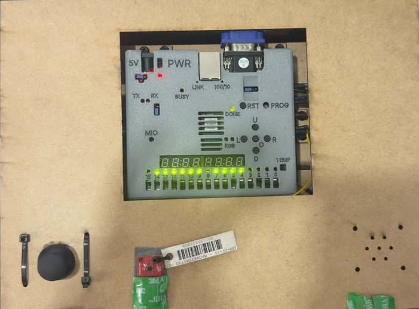
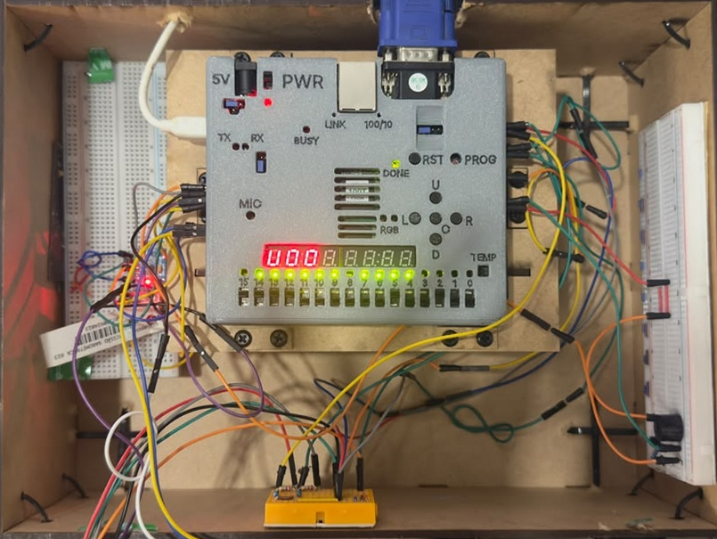
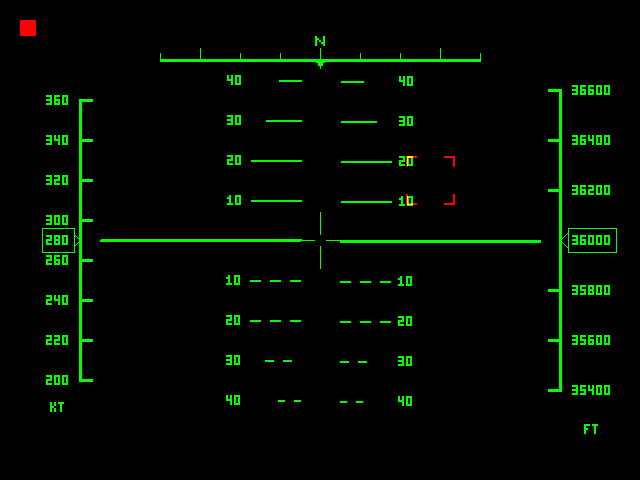

# HUD F-16

**Desenvolvimento de um Head-Up Display em FPGA**

Projeto acadêmico de Engenharia da Computação da PUCRS, desenvolvido na disciplina de Sistemas Digitais com uso do laboratório IDEAR para o desafio da AEL Sistemas de 2026.

**Entrega acadêmica concluída · Atualizado em 26/11/2026**

`SystemVerilog` · `Artix-7` · `Nexys A7-100T` · `Vivado 2026.1`

[Apresentação e matriz](presentation/README.md) · [Operação e reprodução](docs/entrega-final.md) · [Arquitetura e esquemas Vivado](docs/hud-v12-12000007/README.md) · [Acervo técnico](docs/README.md)

## O desafio

O projeto gera simbologia de voo em tempo real a partir das coordenadas da varredura VGA. O núcleo procedural desenha retículo, horizonte artificial, escalas, indicador de rumo e marcador com LOCK/UNLOCK. Os modos NORMAL e DECLUTTER controlam a densidade das informações na tela.

A ampliação acadêmica integra sensores, controles e vídeo de fundo. Os fundos DIA e NOITE vêm do microSD. A DDR2 mantém os bancos de quadros usados na reprodução. A simbologia procedural é composta sobre o fundo.

## Protótipo e arquitetura

| Montagem interna | Simulação do núcleo procedural |
| --- | --- |
|  |  |
| Fotografia usada na apresentação acadêmica. | Raster simulado de 640 × 480, referenciado na [CI da base](https://github.com/santosJuca/Trabalho-display-aviao-v2/actions/runs/43741729969). |

O MPU6050 fornece dados de atitude e o HMC5883L fornece a referência magnética. O BMP085 integra o caminho de pressão e dados barométricos. O host SD nativo carrega os bancos de DDR2. O caminho de pixels usa buffers de linha e prefetch, enquanto os instrumentos didáticos do perfil de voo passam por três estágios registrados. A composição final entrega RGB e sincronismos na interface VGA.

O [esquema do pipeline no Vivado](docs/hud-v12-12000007/vivado/07-pipeline-tres-estagios.pdf) mostra os registradores da implementação roteada. A [arquitetura em PDF](docs/hud-v12-12000007/arquitetura.pdf) detalha as interfaces e a [matriz AEL](presentation/HUD_F16_MATRIZ_REQUISITOS_AEL_DEFINITIVO.pdf) relaciona cada requisito à evidência correspondente.

## Resultados técnicos

| Item | Implementação de referência |
| --- | --- |
| Plataforma | Digilent Nexys A7-100T, Artix-7 `xc7a100tcsg324-1` |
| Saída VGA | 640 × 480 pixels ativos |
| Clocks configurados | 100 MHz no domínio principal e 25 MHz no domínio de pixel |
| Utilização pós-rota | 23.631 LUTs, 17.502 flip-flops, 84 DSPs e 0 BRAM tiles |
| Timing pós-rota | WNS +0,167 ns e WHS +0,015 ns |
| Fundo de vídeo | DIA em RGB332 e NOITE em 2 bpp, com microSD e DDR2 |

A equipe confirmou em 26/11 o funcionamento do rumo magnético após a correção da falha de recuperação. O [registro de entrega](docs/entrega-final.md) delimita essa confirmação, os resultados pós-rota e as ressalvas de CDC e timing externo.

## Demonstração e reprodução

A demonstração percorre SOLO, DECOLAGEM, VOO e POUSO e mostra a seleção DIA/NOITE, o marcador, os modos de simbologia e a resposta dos sensores. O [roteiro de apresentação](presentation/HUD_F16_ROTEIRO_DEFINITIVO.pdf) indica a sequência e o tempo previsto.

Use o [guia de operação e reprodução](docs/entrega-final.md) para identificar o snapshot do build aprovado, conferir os hashes e localizar as fontes, constraints, IP e checkpoint. O [atlas elétrico](docs/atlas-eletrico/atlas-eletrico-hud-nexys-a7.pdf) complementa a documentação de montagem.

## Equipe de desenvolvimento

| Integrante |  GitHub |  LinkedIn |  E-mail |
| --- | --- | --- | --- |
| Juarez Fernando Gonçalves dos Santos | [santosJuca](https://github.com/santosJuca) | [Perfil](https://www.linkedin.com/in/juarez-fernando-santos/) | [Juarez.santos00@edu.pucrs.br](mailto:Juarez.santos00@edu.pucrs.br) |
| Állan Viana da Rosa | [Allanvrosa](https://github.com/Allanvrosa) | [Perfil](https://www.linkedin.com/in/állan-viana-da-rosa-979540324/) | [allan.rosa@edu.pucrs.br](mailto:allan.rosa@edu.pucrs.br) |
| Leandro Bitencourt Silveira Junior | [Leandrob-ts](https://github.com/Leandrob-ts) | [Perfil](https://www.linkedin.com/in/leandro-bitencourt-silveira-junior/) | [leandro.junio@edu.pucrs.br](mailto:leandro.junio@edu.pucrs.br) |
| Theo Kirsch | [treoucha](https://github.com/treoucha) | [Perfil](https://br.linkedin.com/in/theo-carvalho-01138a448) | [Theo.kirsch@edu.pucrs.br](mailto:Theo.kirsch@edu.pucrs.br) |

## Agradecimentos

À PUCRS e ao professor Anderson Roberto Pinheiro Domingues, pela orientação na disciplina de Sistemas Digitais. Ao IDEAR, Laboratório Interdisciplinar de Empreendedorismo e Inovação, pelo espaço utilizado no desenvolvimento. À AEL Sistemas, pela proposição do desafio acadêmico.

## Referências

- [Documentação da Nexys A7](https://digilent.com/reference/programmable-logic/nexys-a7/reference-manual)
- [Documentação AMD Vivado](https://docs.amd.com/)
- [Documentação de arquitetura e validação do projeto](docs/README.md)
