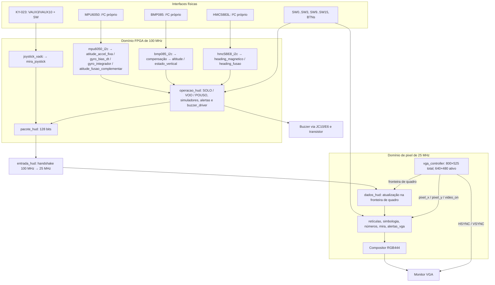

# Arquitetura e montagem elétrica, referência de 21/10/2026

Base: `rtl/top_reticula.sv` e `constraints/nexys_a7_reticula.xdc` no commit `4107002`. As conexões são do XDC atual, não do esquemático histórico de 13/10.

## 1. Fluxo lógico com domínios de clock



Clock de entrada da placa: 100 MHz. O `vga_controller` deriva 25 MHz; saída VGA com 640×480 pixels ativos, 800×525 ciclos por quadro, frequência de aproximadamente 59,52 Hz.

O pacote transferido por `entrada_hud #(.WIDTH(128))` é composto por 32 bits de metadados, 57 bits de dados de voo e 39 bits de posição/estado dos marcadores e LOCK. `dados_hud` aplica a amostra pendente no evento `pixel_x=0` e `pixel_y=480`.

## 2. Três barramentos I²C e GND comum

| Sensor | SDA | SCL | FPGA SDA/SCL |
| --- | --- | --- | --- |
| MPU6050 | JD8 | JD7 | G4 / H2 |
| BMP085 | JD1 | JD2 | H4 / H1 |
| HMC5883L | JD3 | JD9 | G1 / G2 |

Os barramentos são distintos; a referência GND é compartilhada. Não interpretar o uso de LVCMOS33 no XDC como medição ou autorização automática da alimentação dos breakout boards. Conferir tensão real e pull-ups em cada módulo.

**Figura ilustrativa fornecida em conversa:** `Sensores.png`. Esta figura não foi incluída como mídia binária neste commit; é referência de montagem, não evidência experimental nem esquemático elétrico completo.

## 3. Joystick KY-023 e XADC

| Função | Conector | Canal / pino |
| --- | --- | --- |
| Eixo analógico X | JXADC1 (+) e JXADC7 (-) | VAUX3, A13/A14 |
| Eixo analógico Y | JXADC2 (+) e JXADC8 (-) | VAUX10, A15/A16 |
| Botão LOCK | JA1 | C17, ativo em nível baixo com pull-up |

As entradas negativas VAUXN3/VAUXN10 não são pinos GND nativos. A ligação delas ao terra comum é uma configuração de medição unipolar referenciada ao terra.

Os **divisores resistivos ilustrativos** possuem 27 kΩ entre o sinal do joystick e a saída XADC e 10 kΩ entre a saída XADC e o GND:

```text
VRx --[27 kΩ]--+-- JXADC1/VAUXP3
                |
              [10 kΩ]
                |
GND ------------+-- JXADC7/VAUXN3

VRy --[27 kΩ]--+-- JXADC2/VAUXP10
                |
              [10 kΩ]
                |
GND ------------+-- JXADC8/VAUXN10
```

Para 3,3 V na entrada e resistores nominais, `Vout = 3,3 × 10/(27+10) ≈ 0,892 V`. Trata-se de cálculo teórico **apenas se a montagem coincidir com essa topologia**. Foram relatadas anteriormente leituras acima de 1 V em outra condição de montagem; a tensão efetiva nos terminais do XADC ainda precisa ser medida antes de atestar segurança elétrica.

O RTL troca os eixos analógicos e corrige a orientação vertical conforme a montagem. O joystick foi confirmado funcionalmente em 21/10/2026; essa confirmação não equivale a validar a faixa elétrica XADC.

**Figura ilustrativa fornecida em conversa:** `Joysitckmontagem.png` (nome original). Também não incluída como binário no repositório neste commit.

## 4. Buzzer

Pinagem **atual**: `buzzer_out` no JC10/E6, LVCMOS33. Ligação relatada: saída JC10 → resistor de base de 1,2 kΩ → base do 2N2222A; emissor ao GND comum; coletor ao negativo do buzzer ativo; positivo do buzzer em 3,3 V. O acionamento é digital por `buzzer_driver`, com ACK em BTNC/N17. O operador confirmou funcionamento do buzzer em 21/10.

Não utilizar diagramas anteriores que indiquem JC7/E7 ou o botão KY-023 no conector antigo. A validação de corrente e nível elétrico do estágio de acionamento ainda é limitada.

## 5. Distinção das evidências

- **RTL/XDC:** prova quais portas e interfaces foram declaradas no projeto.
- **Desenhos ilustrativos:** explicam a montagem pretendida; não medem tensão nem precisão.
- **Testes simulados:** verificam cenários digitais determinados.
- **Bancada de 21/10:** confirma resposta funcional relatada, sem caracterização quantitativa.

Referências internas: [pinagem](pinagem.md), [sensores](sensores.md), [modos/alertas](modos_alertas_buzzer.md), [validação e rastreabilidade](validacao_e_rastreabilidade_20261021.md). Referências externas: [Digilent Nexys A7](https://digilent.com/reference/programmable-logic/nexys-a7/reference-manual), [Master XDC Digilent](https://github.com/Digilent/digilent-xdc/blob/master/Nexys-A7-100T-Master.xdc), [AMD UG480 XADC](https://docs.amd.com/r/en-US/ug480_7Series_XADC).
