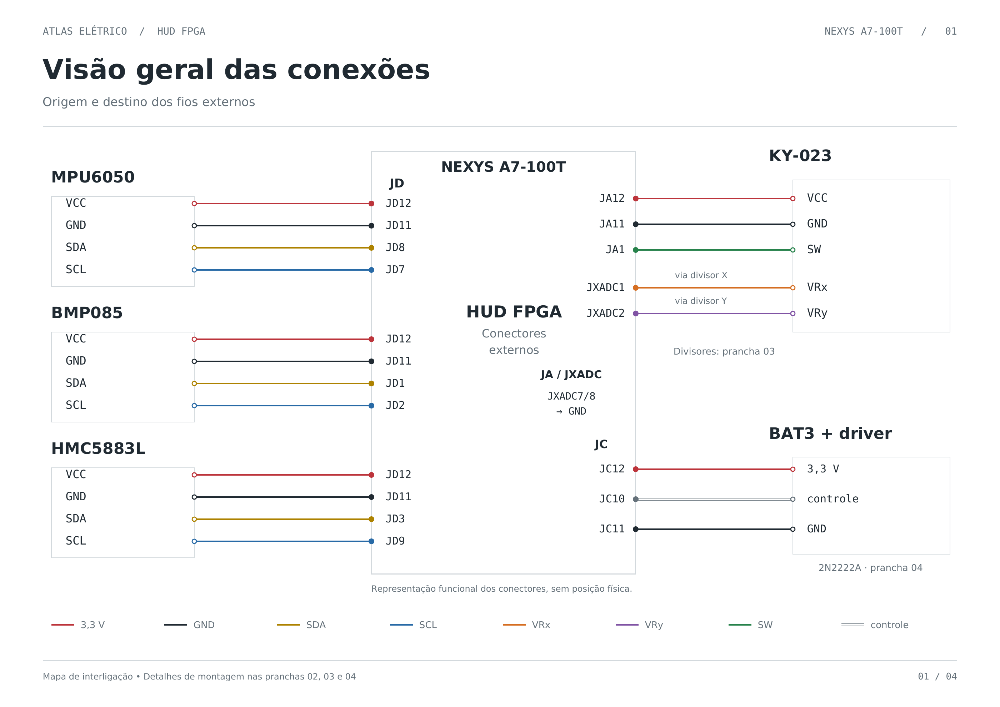
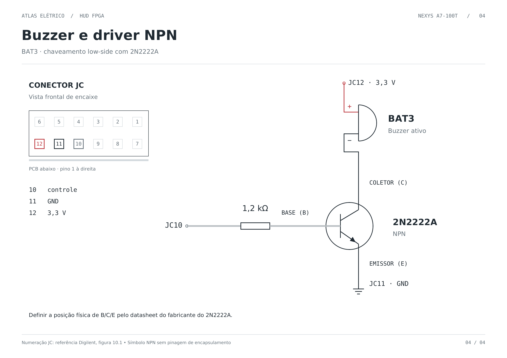

# Atlas elétrico do HUD FPGA

Quatro pranchas de montagem para a Nexys A7-100T, com o mapeamento original de sensores, joystick e buzzer.

[PDF vetorial para impressão](atlas-eletrico-hud-nexys-a7.pdf) · [Pacote completo](atlas-completo-png-svg-pdf.zip)

| Prancha | Imagem | Vetor editável |
| --- | --- | --- |
| 01. Visão geral das conexões | [PNG](01-visao-geral.png) | [SVG](01-visao-geral.svg) |
| 02. Sensores | [PNG](02-sensores.png) | [SVG](02-sensores.svg) |
| 03. Joystick e XADC | [PNG](03-joystick-xadc.png) | [SVG](03-joystick-xadc.svg) |
| 04. Buzzer e driver NPN | [PNG](04-buzzer.png) | [SVG](04-buzzer.svg) |

A visão geral apresenta os conectores em ordem funcional, sem indicar sua posição física na placa. A prancha do buzzer mostra o conector JC em vista frontal de encaixe.

Conferir a compatibilidade de alimentação e os pull-ups dos módulos antes de energizar. Identificar as pernas B/C/E do 2N2222A pelo datasheet do fabricante.

Referência: [manual oficial da Digilent, figura 10.1](https://digilent.com/reference/_media/reference/programmable-logic/nexys-a7/nexys-a7_rm.pdf#page=25).
