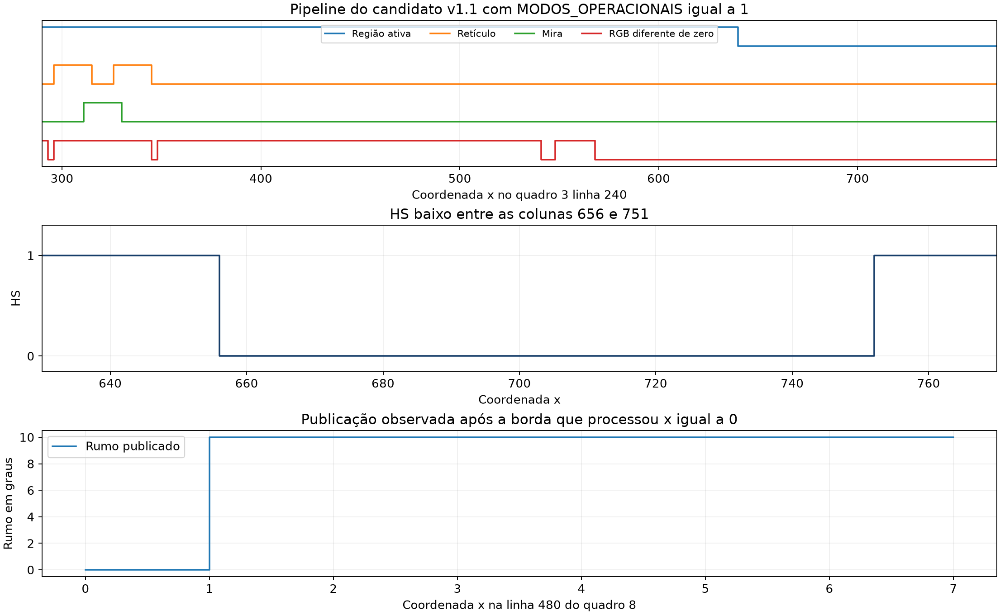

# Pipeline gráfico do MVP v1.1

O perfil acadêmico usa geração procedural com `MODOS_OPERACIONAIS=1`,
`FULL_ATTITUDE=1` e SD, overlay SD e vídeo SD desabilitados. Essa configuração
usa o caminho VGA da base v1.1 e dispensa framebuffer externo.

| Item | Identificação |
| --- | --- |
| Fontes acadêmicas | `28e736db2b0962ae3494660a8b84944ad087d8c5` |
| Origem do build Vivado | `c481ceb9858b58baa99c1da6fe8a48f50f7630ea` |
| BIT do candidato | SHA-256 `4bbb80662a517d059c862e1f92170716523cef34200e439e03cf51603cb5e735` |
| DCP roteado | SHA-256 `068b93b3ec7f74c536dd569abaa3e04539bcc4386b0ee8d9bc7b30e0819142f1` |
| Entradas verificadas pelo runner | [Perfil](perfil.json) com 34 parâmetros, 63 fontes HDL e duas constraints |

O banco `tb_mvp_v11_entrega` percorre o raster 800×525 a 25 MHz. A validação de
15/11/2026 verificou 20 quadros completos e 8.400.000 posições, com HS/VS, RGB preto
no blanking, estilos original e CAÇA, NORMAL/DECLUTTER e prioridade de composição.
A posição das camadas é calculada a partir das coordenadas e do estado publicado na
fronteira do quadro. A figura mostra uma janela da simulação, com observação
pós-borda. Essa amostragem não mede atraso físico.



Com Python 3, Verilator, C++, make e Icarus, na raiz:

```bash
bash scripts/validate_mvp_v11.sh build/mvp-v11-novo
```

O runner confere as entradas, reproduz o raster e roda cinco regressões
complementares. A captura usa sensores indisponíveis e modelo de XADC. Confira o
[guia acadêmico](../../entrega_demo.md) para os requisitos da demonstração.

Os [relatórios da implementação original](../../consolidacao_20261106/evidencias/hud/)
registram WNS +0,147 ns, WHS +0,009 ns, 15.182 LUTs, 9.581 FFs, 62 DSPs e zero
BRAM. A Fmax estimada no DCP é 101,492 MHz no domínio principal e 66,059 MHz
no domínio de pixel. O cálculo usa `1000 / (período − slack)` para caminhos de
setup de um ciclo no mesmo domínio, com período e slack em ns.

O pacote acadêmico local preserva relatório, apresentação, BIT, DCP, CSV,
VCD amostrado e manifesto de integridade.
A demonstração física do BIT e a revisão final do grupo seguem pendentes.
