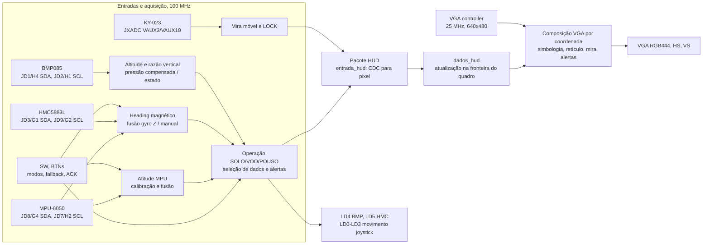

# Registro histórico da entrega de 08/10/2026

Os controles, artefatos e pendências abaixo pertencem à versão identificada no registro.
Consulte o [guia de entrega atual](../entrega_demo.md) para escolher o conjunto correto.

# Entrega e demonstração do HUD

Este documento reúne o estado físico informado da demonstração, o roteiro de apresentação e os registros do bitstream aprovado. Os resultados físicos abaixo foram fornecidos pelo operador; não há fotos, vídeos, instrumentos ou medições anexados a esta árvore para verificá-los de forma independente. A data e as condições elétricas detalhadas dos ensaios não foram registradas.

## Versão congelada para demonstração

| Item | Registro |
| --- | --- |
| Projeto / branch auditada | `Trabalho-display-aviao-v2`, `feat/modos-alertas` |
| HEAD auditado nesta preparação | `fc2a687285777ab7e577a4f5cb95ef7de0582866` (`Consolida documentacao tecnica das branches historicas`) |
| Bitstream aprovado | [`2026-10-08_hud_caca_marker/top_reticula.bit`](https://github.com/santosJuca/Trabalho-display-aviao-v2/blob/11343bb/bitstreams/2026-10-08_hud_caca_marker/top_reticula.bit) |
| Build do artefato | Vivado 2026.1, build 6511674; dispositivo `xc7a100tcsg324-1`; fonte associada ao commit `de568516c863b2f10eae73f8890b1671bc18c1f2` (tag `hud-20261008-caca-marker`) |
| Tamanho | 3.825.992 bytes |
| SHA-256 conferido nesta auditoria | `e55d29a48ed0ace7a7a7d94d512f8b05fa465905cf1d78a5317b047a32782c49` |
| Resultado registrado do build | Testes, síntese, implementação roteada e geração do bitstream aprovados; WNS +0,078 ns, TNS 0,000 ns, WHS +0,017 ns, THS 0,000 ns; DRC com 0 erros e 55 avisos |
| Relação entre o HEAD e o build | O HEAD auditado contém documentação consolidada posterior; o bitstream foi gerado a partir do commit-fonte/tag indicado acima, não do HEAD atual. Nenhuma recompilação foi feita nesta preparação. |

O arquivo não foi alterado. A associação de build e os relatórios detalhados estão em [`bitstreams/2026-10-08_hud_caca_marker/README.md`](https://github.com/santosJuca/Trabalho-display-aviao-v2/blob/11343bb/bitstreams/2026-10-08_hud_caca_marker/README.md). O hash acima identifica os bytes do arquivo no checkout auditado.

## Validação física informada

| Área | Resultado relatado | Ressalva |
| --- | --- | --- |
| VGA | Imagem estável | Sem captura ou medida de sincronismo anexada |
| SW0 / SW1 | Funcionaram | SW0 seleciona NORMAL/DECLUTTER; SW1 seleciona estilo HUD/CAÇA |
| Operação | SOLO, VOO, POUSO e fallback para entrada `11` funcionaram | Entrada inválida retorna a SOLO com indicação conforme RTL |
| Atitude manual | Pitch e roll responderam pelos switches | Demonstração de fallback, não medição angular calibrada |
| Heading manual | BTNU e BTND responderam | Passo nominal do RTL: 10° por acionamento; não foi medida precisão física |
| MPU-6050 | Funcional e recuperado após falha/reconexão | Sem registro de duração, causa ou repetição quantitativa |
| BMP085 | 3/3 ensaios aprovados; recuperação também funcionou | Contagem transcrita do relato; sem logs ou condições anexados |
| HMC5883L | 5/5 ensaios em operação; recuperado no reteste após episódio intermitente | `HDG BAD` apareceu brevemente; após reconexão o heading voltou. Não há diagnóstico de causa-raiz |
| Alertas de roll/pitch | CAUTION e WARNING, histerese e ACK aprovados em 6/6 ensaios | Contagem transcrita do relato; não é certificação de limiares para uso aeronáutico |
| Joystick | Movimento e LOCK/UNLOCK aprovados | Deslocamento para a esquerda lento; pendente de ajuste ou caracterização |

O aviso breve `HDG BAD` deve ser apresentado como indicação transitória observada durante a recuperação do heading. A observação de recuperação não prova que o aviso tenha uma duração adequada em todas as falhas.

### Elementos vermelhos e diagnóstico do quadrado

O RTL contém dois elementos diferentes que podem ser descritos como quadrado vermelho:

- **Quadrado sólido no alto à esquerda, aproximadamente `(20..35, 20..35)`:** é o indicador de estado do MPU-6050. O compositor o pinta de vermelho quando `sensor_ok=0` e de verde quando `sensor_ok=1`; `sensor_ok` só sobe depois que o driver reconhece o MPU e publica uma amostra completa. Assim, vermelho durante inicialização ou recuperação I²C é compatível com a lógica. Se permanecer vermelho depois de o MPU voltar a fornecer amostras, isso não representa estado normal e deve ser registrado como falha/estado ainda não recuperado. O indicador é mostrado no estilo HUD original e some com DECLUTTER; não é controlado por SOLO/VOO/POUSO.
- **Quatro cantos vermelhos no centro-direita, em torno de `(430,180)`:** são o marcador fixo abaixo, não o indicador do MPU.

Sem uma imagem não dá para afirmar qual dos dois corresponde ao que foi visto. A cor e a posição ajudam a distinguir: bloco sólido pequeno no alto à esquerda indica estado do MPU; quatro cantos ao redor de uma área vazia no centro-direita são o marcador visual fixo.

### Marcador vermelho no estilo HUD original

A inspeção do RTL confirma que o marcador é formado por quatro cantos vermelhos fixos, gerados por `simbologia_vga` em torno de `(430,180)` e pintados no compositor de `top_reticula.sv`. Ele aparece quando SW1 seleciona o estilo HUD original (`style_mode=0`) e fica oculto no estilo CAÇA (`style_mode=1`). A condição depende do estilo visual, não da operação SOLO/VOO/POUSO nem do SW0 NORMAL/DECLUTTER; portanto, também aparece durante VOO no estilo original. Não acompanha a mira, não é calculado a partir de sensor e não representa um alvo detectado. No estado atual é apenas um marcador fixo de demonstração e pode parecer sem função no VOO.

Para esta versão congelada, a alternativa sem alterar o bitstream é demonstrar o estilo CAÇA, que oculta o marcador e muda também outros elementos do HUD. Se a apresentação exigir VOO no estilo original sem esse quadrado, isso requer uma alteração futura no RTL e um novo build/bitstream; não se deve afirmar que o marcador foi removido desta versão.

### Limites que permanecem

- Não foi registrada calibração do magnetômetro em várias orientações, estimativa de hard/soft iron, nem comparação do heading com uma referência absoluta. Portanto, não afirmar precisão absoluta ou erro em graus.
- O heading é calculado pelo caminho magnético plano XY e pode depender da orientação e do ambiente. LD5 indica identificação/configuração, não calibração.
- As entradas analógicas do joystick usam VAUX3 e VAUX10 do XADC. A faixa elétrica segura da montagem, alimentação, referência e condicionamento analógico precisam ser conferidos nos módulos e na placa. Não há valores medidos registrados e `LVCMOS33` do XDC não valida entradas analógicas.
- O deslocamento para esquerda permanece pendente; não apresentar o joystick como uniformemente caracterizado nos quatro sentidos.
- VOO e POUSO são modos de simulação didática. Mira/LOCK não representam detecção ou rastreamento de alvo real; `buzzer_out` é interno e não há buzzer físico mapeado.
- O quadrado vermelho do HUD original é fixo e não tem entrada funcional; identificá-lo como marcador visual de demonstração, não como alvo.
- O quadrado sólido de status do MPU deve ficar verde após o driver voltar a receber amostras válidas. Vermelho breve na inicialização/recuperação é esperado pela lógica atual; persistência após recuperação precisa de verificação.

## Diagrama de arquitetura

Fluxo resumido a partir das instâncias em `rtl/top_reticula.sv`. O caminho de exibição opera no domínio VGA derivado do clock da placa.

O diagrama é funcional, não representa todos os sinais internos nem garante a fiação/alimentação dos módulos. Para os pinos e conectores completos, consultar o [mapa de conexões](../pinagem.md), verificado contra o top e o XDC versionados.

## Roteiro de demonstração

1. Mostrar a placa Nexys A7-100T, a tela VGA e os módulos conectados. Identificar GND comum e os três barramentos I²C independentes sem inferir que a pinagem, sozinha, comprova tensões corretas.
2. Exibir o HUD estável. Alternar SW0 entre NORMAL e DECLUTTER e SW1 entre HUD original e CAÇA.
3. Alternar SW3:SW2 por SOLO (`00`), VOO (`01`), POUSO (`10`) e estado inválido (`11`), apontando que VOO/POUSO são modos didáticos.
4. Demonstrar pitch em SW13:SW12 e roll em SW15:SW14 como fallback de bancada. Em seguida mostrar a atitude do MPU-6050 e o seu indicador de estado.
5. Mostrar o heading do HMC5883L e variar a orientação do módulo com cuidado. Não apresentar isso como teste de calibração absoluta. Opcionalmente mostrar BTNU/BTND como ajuste manual.
6. Mostrar LD4 para o BMP085 e a altitude/indicação correspondente; evitar alegar precisão sem referência de comparação.
7. Movimentar o joystick nos sentidos disponíveis e alternar LOCK/UNLOCK. Registrar em vídeo o movimento lento para a esquerda como ressalva conhecida.
8. Demonstrar CAUTION/WARNING por pitch/roll e reconhecer o alerta com BTNC. Deixar visível a histerese e distinguir ACK lógico de buzzer físico, que não está conectado.
9. Se a recuperação do heading for demonstrada, registrar a sequência completa, inclusive o aviso `HDG BAD` breve e o retorno do heading, sem provocar condições elétricas inseguras.

## Checklist de evidências

### Fotos

- [ ] Visão geral da placa, tela e montagem, com cabos e módulos identificáveis.
- [ ] Detalhe dos módulos MPU-6050, BMP085 e HMC5883L e respectivos conectores JD.
- [ ] Detalhe do joystick e ligação ao JXADC/JA, sem esconder eventual condicionamento.
- [ ] Tela em NORMAL e DECLUTTER.
- [ ] Tela em estilos HUD e CAÇA.
- [ ] Um exemplo de cada operação SOLO, VOO e POUSO, além de `11` inválido.
- [ ] Exemplos de atitude, heading, dados barométricos, mira LOCK/UNLOCK e alertas.

### Vídeo

- [ ] Começar com a identificação da versão demonstrada: bitstream 08/10/2026 e SHA-256 deste documento.
- [ ] Capturar tela e manipulação dos controles na mesma tomada quando possível.
- [ ] Mostrar resposta a cada controle com tempo suficiente para a câmera registrar o estado.
- [ ] Incluir pelo menos uma sequência contínua dos sensores e a transição de recuperação observada do HMC5883L, se repetida naturalmente.
- [ ] Mostrar deslocamento lento para a esquerda do joystick como pendência, sem editar para sugerir resposta simétrica.
- [ ] Não alegar calibração absoluta, segurança elétrica medida ou função de buzzer físico.
- [ ] Guardar originais com data e uma legenda indicando quais resultados são demonstração física e quais pertencem à simulação.

## Esqueleto de apresentação

1. **Problema e objetivo**: HUD gráfico como projeto acadêmico de Sistemas Digitais.
2. **Plataforma**: Nexys A7-100T, Artix-7, SystemVerilog e saída VGA 640×480.
3. **Arquitetura**: três sensores I²C, joystick via XADC, lógica operacional, travessia de domínio e renderização por coordenadas.
4. **Interação**: SW0/SW1, modos SOLO/VOO/POUSO, fallback de pitch/roll e ajuste manual de heading.
5. **Demonstração**: imagem VGA, sensores, mira móvel/LOCK e alertas.
6. **Validação**: separar regressão simulada e build Vivado dos resultados físicos relatados; mostrar contagens físicas somente como observações informadas.
7. **Limitações**: movimento lento à esquerda, aviso `HDG BAD` breve, calibração/precisão absoluta do HMC5883L não verificada, faixa segura do XADC sem medição documentada e buzzer sem saída física.
8. **Conclusão**: versão de demonstração congelada no bitstream identificado; próximos passos são registrar evidências, caracterizar pendências e não alterar a versão demonstrada sem novo registro.
