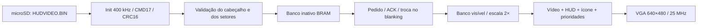

# Reprodução de vídeo microSD com overlay HUD

## Estado e limites da entrega

Implementação experimental em `feat/video-sd-overlay`, partindo de `0271499a8538135abc6291e512b421382337c7c2`. A branch e o HEAD eram exatamente esses no início. Já existiam nove arquivos rastreados modificados e recursos da integração física do ícone ainda não rastreados. Nenhuma alteração local foi descartada. Não houve commit, push, merge, programação JTAG, gravação de Flash ou escrita em cartão.

O diretório desta execução é `validation/sd-video-20261030T173402Z/`. `initial.json` registra o estado anterior e os hashes de 255 arquivos. `before.tar` foi relido e conferido contra esses hashes. `initial.patch` preserva também o diff anterior. Os arquivos sincronizados do projeto ChatGPT em `sources/` não foram alterados.

A reprodução física permanece pendente. O leitor USB apresentava `/dev/sdc` com capacidade de **0 bytes** durante esta execução. Não foi possível conferir espaço livre atual, copiar ou mapear um vídeo real. A evidência anterior confirma somente o ícone físico, não vídeo. O novo bitstream usa o LBA **1000 exclusivamente do modelo de simulação** e não está provisionado para o cartão do usuário. É obrigatório recompilar a partir do mapa real antes da programação manual.

Recuperação já disponível, preservada:

`validation/sd-overlay-20261030T165217Z/implementation-2/experimental.bit`

O hash inicial desse arquivo está em `initial.json`. A confirmação física anterior continua em `validation/sd-overlay-20261030T165217Z/physical-confirmation-20261030T172145Z/result.json`.

## Decisão de arquitetura

Escolha: **CMD17 sequencial + CRC16 por setor + dois framebuffers RGB332 em BRAM + publicação no blanking + composição por máscara HUD**.



As alternativas A e C não são mutuamente exclusivas: leitura contínua do cartão precisa de armazenamento para desacoplar sua latência da VGA. Esta entrega combina as duas. Não há fila de setores adicional porque o leitor entrega no máximo um byte a cada oito clocks SPI e a porta de escrita da BRAM aceita um byte por clock de sistema.

| Alternativa | Capacidade e acesso | Integração neste checkout | Decisão |
|---|---|---|---|
| Dois bancos BRAM | 153.600 bytes de imagem em 320×240; portas independentes de escrita e leitura | Reaproveita buffer existente e seu handshake | Principal |
| DDR2 + MIG + FIFO de linha | 128 MiB; precisa arbitrar leituras, escritas, refresh e latência variável | Não há controlador, PHY, IP MIG, interface DDR2 ou pinagem DDR2 ativa no projeto | Não justificada para este perfil |
| SPI contínuo + FIFO/BRAM | Vazão média do SPI limita quadros novos; framebuffer mantém a VGA contínua | CMD17 já validado, CRC e timeouts existentes | Usada com os dois bancos; sem FIFO extra |

O XC7A100T oferece 63.400 LUT, 126.800 FF, 240 DSP e 135 RAMB36, total de 4.860 Kibit brutos. A capacidade em configurações de oito bits não equivale a todos os bits brutos: a paridade e o arredondamento de profundidade também ocupam blocos. Nesta implementação, o endereço tem 17 bits por banco, reservando 131.072 bytes por banco; são 64 RAMB36 para vídeo. O ícone e a referência preservam mais dois RAMB18. Fonte: [AMD DS180](https://docs.amd.com/v/u/en-US/ds180_7Series_Overview) e relatórios Vivado desta execução.

A placa contém DDR2 Micron x16 de 128 MiB. O manual recomenda clock de aproximadamente 325 MHz, 650 MT/s, ou teto descrito de 667 MT/s. O pico teórico x16 a 650 MT/s seria 1,3 GB/s; isso não é vazão sustentável medida. **Frequência DDR2 efetiva, latência e vazão sustentável neste projeto: indisponíveis, pois não existe controlador integrado.** Seriam necessários MIG/PHY, calibração, clocks, constraints físicas e arbitragem. Fonte: [manual Nexys A7, seção 3.1](https://digilent.com/reference/_media/reference/programmable-logic/nexys-a7/nexys-a7_rm.pdf).

Dois quadros não limitam a duração do arquivo: cada próximo quadro vem do cartão. Não há preload do vídeo inteiro. Em tese, 128 MiB acomodariam 1.747 quadros RGB332 de 320×240, cerca de 174,7 s a 10 FPS, descontadas reservas. Isso não acelera a carga inicial nem elimina o gargalo SPI para conteúdo novo. Não há necessidade demonstrada dessa capacidade nesta versão.

## Perfis e vazões

Valores decimais, sem cabeçalho nem padding:

| Perfil | Dados por quadro | FPS | Demanda de leitura |
|---|---:|---:|---:|
| 160×120 RGB332 | 19.200 B | 10 | 192.000 B/s; 194.560 B/s com padding |
| 320×240 RGB332 | 76.800 B | 10 | 768.000 B/s |
| 320×240 RGB565 | 153.600 B | 10 | 1.536.000 B/s |
| 640×480 RGB565 | 614.400 B | 30 | 18.432.000 B/s |
| 640×480 RGB565 | 614.400 B | 60 | 36.864.000 B/s |

O RTL implementa **RGB332, 320×240 com escala 2× ou 160×120 com escala 4×**, sempre ocupando 640×480. RGB565, paleta e RLE foram comparados, mas não implementados: aumentariam tráfego ou lógica sem necessidade para demonstrar movimento. Não existe decodificador MP4/H.264 na FPGA.

A VGA mantém 25 MHz, 800×525 períodos por quadro e aproximadamente 59,524 Hz. Seu consumidor BRAM lê até um byte por pixel ativo: 25 MB/s instantâneos e 18,286 MB/s na média do raster. Essa vazão local é independente dos 768 KB/s de quadros novos a 10 FPS. A porta de escrita opera a 100 MHz, a leitura a 25 MHz, simultaneamente em bancos distintos. A latência é de dois pixels por causa dos registros de endereço/enable e da leitura síncrona. O fluxo usa prefetch para absorvê-la.

### SPI medido no modelo

`frequency-sweep/results.txt` contém 14 execuções do benchmark existente, três setores em cada uma. Inicialização sempre com divisor 125, ou 400 kHz. Foram usados dois modelos de atraso: R1/token de 1/0 e 12/16 bytes adicionais. Todos os bytes e CRC16 foram conferidos. Os valores abaixo são **simulados**, não medições do QD101.

| Meio período a 100 MHz | SCK real | Vazão útil simulada, dois modelos | Limite por leitura, 320×240 |
|---:|---:|---:|---:|
| 125 | 0,400 MHz | 46.377–48.762 B/s | 0,604–0,635 FPS |
| 50 | 1,000 MHz | 115.941–121.904 B/s | 1,510–1,587 FPS |
| 25 | 2,000 MHz | 231.881–243.806 B/s | 3,019–3,175 FPS |
| 13 | 3,846 MHz | 445.919–468.852 B/s | 5,806–6,105 FPS |
| 6 | 8,333 MHz | 966.129–1.015.813 B/s | 12,580–13,227 FPS |
| 5 | 10,000 MHz | 1.159.342–1.218.961 B/s | 15,096–15,872 FPS |
| 4 | 12,500 MHz | 1.449.152–1.523.673 B/s | 18,869–19,840 FPS |

O divisor inteiro não produz exatamente 4 ou 8 MHz. Nenhuma alteração de clock ocorre por switch durante uma transação. O parâmetro de leitura é escolhido no build; a inicialização conserva 400 kHz.

A 400 kHz, 320×240 terá movimento lento, aproximadamente 0,6 FPS no modelo, e 160×120 terá teto próximo de 2,4 FPS. Não se afirma que 10 FPS foi alcançado fisicamente. Para a meta de 320×240 a 10 FPS, o modelo sugere divisor 6 ou menor, com margem para a latência simulada. A versão experimental local conserva divisor 125. RGB565 a 10 FPS exige mais que o útil medido mesmo a 12,5 MHz. Os perfis VGA RGB565 excedem amplamente essa interface.

**Qualificação física por frequência:** quantidade de leituras, taxa de erros, CRC, timeouts, comportamento após reset e vazão sustentada continuam sem medição nesta entrega. O timeout de token mantém os 250 ms já implementados e escala em função do divisor. A publicação física anterior do ícone a 400 kHz não qualifica frequências maiores. O [product brief WD QD101](https://documents.westerndigital.com/content/dam/doc-library/en_us/assets/public/western-digital/collateral/product-brief/product-brief-wd-purple-sc-qd101-ultra-endurance-microsd.pdf) informa SDA 6.0 e classes de velocidade, mas não fornece o orçamento AC SPI necessário para aprovar automaticamente esses clocks. A [SD Association](https://www.sdcard.org/downloads/pls/) disponibiliza a documentação pública simplificada; as classes comerciais não substituem a medição do enlace SPI.

CMD18 reduziria overhead de comandos, mas não resolve o teto bruto de 50 KB/s a 400 kHz. CMD17 já supera 768 KB/s nos modelos a 8,333 MHz. Por isso CMD18, CMD12 e FIFO de transferência não foram adicionados. Não existem testes ou alegação de suporte desses comandos novos. Se a medição física demonstrar que o overhead CMD17 impede a meta em um clock qualificado, esse será o motivo concreto para revisitar CMD18.

## Formato HUDVIDEO v1

Arquivo `HUDVIDEO.BIN`, distinto de `HUDICON.BIN`. Sem áudio, sem compressão. Cabeçalho de 512 bytes, inteiros little-endian. Pixels row-major, da esquerda para a direita e de cima para baixo.

| Offset | Bytes | Campo |
|---:|---:|---|
| 0 | 8 | Magic ASCII `HUDVID1` seguido de zero |
| 8 | 2 | Versão = 1 |
| 10 | 2 | Cabeçalho = 512 bytes |
| 12 | 2 | Largura, 160 ou 320 |
| 14 | 2 | Altura, 120 ou 240 |
| 16 | 2 | FPS inteiro, 1–60 |
| 18 | 2 | Formato = 1, RGB332 |
| 20 | 4 | Quantidade de quadros, mínimo 2 |
| 24 | 4 | Bytes úteis por quadro |
| 28 | 4 | Stride do quadro, arredondado para múltiplo de 512 |
| 32 | 4 | Tamanho total, cabeçalho mais quadros com padding |
| 36 | 4 | Primeiro setor de dados relativo ao arquivo = 1 |
| 40 | 16 | Identificador UUID da sequência, não zero |
| 56 | 456 | Reservado, zero |

RGB332: R em bits 7:5, G em 4:2, B em 1:0. Expansão VGA RGB444 por repetição dos bits mais significativos: `RRRr GGGg BBbb`. Um quadro 320×240 ocupa exatamente 150 setores. Um quadro 160×120 ocupa 38 setores, incluindo 256 bytes finais de padding. O padding não entra no framebuffer, mas recebe validação CRC de transporte.

`metadata.json` registra origem, UUID, perfil, contagem, tamanho, SHA-256 do arquivo, SHA-256 de cada quadro útil e CRC16 de cada setor de imagem. O controlador recebe também o CRC16 calculado pelo próprio cartão. Hashes offline e CRC de transporte cumprem funções diferentes. O cabeçalho é validado pela FPGA, inclusive reservados zero, geometria, FPS e correspondência exata com a extensão de arquivo conferida no PC.

## Conversão local

A ferramenta usa Python padrão e FFmpeg já instalado. O diretório de saída precisa ser novo; ela não sobrescreve saídas nem escreve em dispositivos. Exemplo, dentro do repositório:

```sh
python3 tools/convert_video_for_fpga.py /tmp/hud-video-real --input /caminho/video.mp4 --width 320 --fps 10 --seconds 2
```

`--seconds` limita a duração tanto da entrada real quanto da sintética; o padrão
é 2 segundos. Para outra duração, informe o valor explicitamente. A saída continua
exigindo pelo menos dois quadros. Este conversor RGB332 é da base v1.1; não
substitui o gerador do vídeo B++ 2 bpp do firmware recente.

Para gerar uma sequência sintética local:

```sh
python3 tools/convert_video_for_fpga.py /tmp/hud-video-sintetico --synthetic --width 320 --fps 10 --seconds 2
```

O arquivo sintético desta execução está em `validation/sd-video-20261030T173402Z/synthetic/HUDVIDEO.BIN`: 10 quadros, 768.512 bytes. Serve para conversão e simulação; não é prova de vídeo físico. Um erro de conversão deixa o diretório para diagnóstico; somente uma execução bem-sucedida com `metadata.json` válido produz um resultado aprovado para o próximo passo.

## Mapeamento e integridade do cartão

| Método | Limite | Uso nesta versão |
|---|---|---|
| LBA fixo sem conferência | Pode apontar para outro arquivo após mudanças no FAT | Recusado como procedimento físico |
| Arquivo contíguo conferido no PC | Exige estabilidade da alocação e recompilação após mudança | Escolhido |
| Lista de extensões | Aceita fragmentação, mas exige tabela e sequenciador na FPGA | Não necessária para a primeira demonstração |
| FAT32 somente leitura na FPGA | Resolve nome e cadeia dinamicamente, com parser maior | Não implementado |

O mapeador `tools/map_sd_video.py` abre o dispositivo com `O_RDONLY`, valida MBR/BPB/FAT32, confere as cópias da FAT, percorre a cadeia de clusters, detecta ciclos e fragmentação, verifica tamanho e compara todo o arquivo com a referência local em blocos limitados. Também calcula espaço livre pela FAT. Exige `HUDVIDEO.BIN` na raiz, sem FAT ativo alternativo. Uma imagem regular local é aceita para testes, sempre identificada como imagem, não como cartão físico.

Não foi reaproveitado o LBA 30006080: ele pertence ao `HUDICON.BIN`, preservado. Nenhum LBA real de vídeo foi inventado. O valor 1000 só pertence ao modelo de teste.

Após autorização expressa para a cópia, o procedimento manual é:

1. Identificar o QD101 por dispositivo, capacidade, partição e conteúdo já conhecido. Conferir o sistema FAT32 e o espaço livre antes da cópia. Fazer backup proporcional, incluindo `HUDICON.BIN` e a estrutura FAT. Não formatar nem escrever setores brutos.
2. Copiar somente `HUDVIDEO.BIN` para a raiz por meio do sistema de arquivos, sem substituir nenhum arquivo existente. Comparar seu SHA-256 com `metadata.json`, sincronizar e desmontar com segurança.
3. Com o dispositivo identificado, conferir o mapa em modo somente leitura. Exemplo, apenas se `/dev/sdc` for realmente o cartão nessa sessão:

```sh
python3 tools/map_sd_video.py /dev/sdc /tmp/hud-video-real/HUDVIDEO.BIN /tmp/hud-video-map.json
```

4. Se houver fragmentação ou divergência, parar. Não forçar contiguidade por gravação bruta ou formatação. Uma cópia contígua validada é requisito desta versão.
5. Recompilar com o mapa conferido. O wrapper abaixo relê o dispositivo e a referência, e rejeita alteração de LBA, tamanho, UUID, hash ou MBR:

```sh
python3 tools/build_video_bitstream.py /tmp/hud-video-build --map /tmp/hud-video-map.json --read-half 125
```

6. Não alterar o arquivo nem a alocação após mapear. Antes de usar clock maior, qualificar o enlace e selecionar o divisor correspondente em um novo build. A ferramenta de build não programa hardware.

A montagem usada para copiar, o espaço livre atual e a fragmentação real permanecem desconhecidos enquanto o cartão não estiver disponível. A escrita e a programação não estão autorizadas nesta execução.

## Quadros, falhas e CDC

O carregador só inicia um quadro com banco inativo livre. Cada CMD17 precisa receber exatamente 512 bytes ordenados, CRC válido e conclusão válida. Os bytes podem entrar provisoriamente no banco inativo; um único setor inválido aborta o quadro inteiro. Não existe publicação parcial.

O buffer é o `sd_sector_buffer.sv` anterior, agora parametrizado por quantidade de bytes e largura de endereço; os valores padrão preservam 512 bytes e a interface do ícone. O pedido alterna o bit identificador do banco. Dois estágios sincronizam pedido e ACK. O leitor troca apenas em `x=0,y=480`, drena duas leituras antes de liberar o banco anterior e impede escrita enquanto aguarda ACK. Os resets locais conservam o padrão existente. Os clocks 100/25 MHz têm relação declarada nas constraints; a robustez do buffer também tem teste com clocks independentes.

A meta FPS controla o intervalo mínimo entre inícios de carga. Quando cartão ou arbitragem atrasam, a VGA repete o último quadro e a taxa de quadros novos cai; não há escrita no banco visível. O contador `late_frames` registra cargas que excederam o período. Não há descarte arbitrário de dados ou quadros parcialmente carregados. O arquivo volta ao quadro zero após o último quadro válido.

Erro de CRC, token ou resposta: aborta, conta erro, espera 100 ms e recarrega o mesmo quadro desde o primeiro setor. Após três tentativas consecutivas com falha, para e mantém o último quadro válido. Erro de formato para sem publicar. Falha de inicialização conserva o HUD. Para recuperar após falha persistente ou trocar o arquivo, reconfigurar manualmente ou reiniciar a placa conforme o procedimento de bancada existente.

O compartilhamento com o diagnóstico mantém um único mestre SPI. O árbitro retém o proprietário da transação, bloqueia pedidos durante o despacho e entrega bytes/erros somente ao consumidor correspondente. O controlador passou a reter o LBA no instante da aceitação; antes, um chamador que liberasse o endereço após o pedido poderia alterar o comando ainda não iniciado. O teste existente do controlador agora muda o LBA imediatamente após esse pedido.

## Composição, controles e diagnóstico

A máscara HUD usa `overlay_on`, `mira_on`, retícula, alvo, horizonte, extras selecionados e indicador do sensor. Nenhum teste de cor preta determina transparência. Um elemento HUD preto continua opaco. Sem desenho HUD e com quadro disponível, aparece o vídeo. Alertas e mira mantêm prioridade sobre o ícone amarelo no build com vídeo; o build antigo sem vídeo mantém sua composição.

`sd_video_background.sv` antecipa X/Y em dois pixels, inclusive ao atravessar linhas e o fim do raster. Endereço, enable, dado e máscara são conferidos contra os pixels esperados. HSYNC, VSYNC e coordenadas do HUD não são deslocados. RGB fica preto no blanking.

BTNL estava livre no top e usa P17 LVCMOS33, conferido no [Master XDC oficial Digilent](https://raw.githubusercontent.com/Digilent/digilent-xdc/master/Nexys-A7-100T-Master.xdc). Recebe sincronização, debounce de 10 ms e alterna vídeo/HUD original. A mudança visual ocorre no blanking. O vídeo fica inicialmente habilitado quando existir quadro válido. O botão não altera a carga dos quadros. SW0/1, SW2/3, SW4–7, SW8, SW9–15, BTNC, BTNU/BTND e joystick preservam suas funções.

SW8 continua solicitando a leitura do ícone quando o diagnóstico está ocioso. Não é um controle de vídeo e não se deve contar com uma borda durante leitura ocupada. LD7 conserva inicialização concluída, LD8 agrega erros incluindo vídeo, LD9 indica ocupação e LD10/LD11 continuam relativos ao diagnóstico do ícone. As páginas 0–11 foram preservadas. Novas páginas SW7..SW4:

| Página hexadecimal | Valor |
|---|---|
| C | Quadros carregados integralmente, não contagem de refresh VGA |
| D | Erros do carregador de vídeo |
| E | Ciclos a 100 MHz gastos na última carga completa |
| F | Bits 31:8 cargas atrasadas (24 bits), bits 7:4 estado, bit 0 falha |

Vazão observável em bancada: `bytes_uteis_do_quadro × 100.000.000 / ciclos_da_pagina_E`. Registrar também tempo entre trocas visíveis, erros e repetições. Códigos de estado: 0 espera init, 1–4 cabeçalho, 5 espera banco/período, 6 início, 7–9 setor, A commit, B retry, C parado.

## Arquivos e verificação

Criados: `rtl/sd_video_loader.sv`, `rtl/sd_video_background.sv`, ferramentas em `tools/`, `scripts/build_sd_video.tcl`, `scripts/test_video.sh`, modelo SD e testes de vídeo. Reutilizados: inicialização SDHC, CMD17, CRC16, timeout, buffer com handshake, controlador VGA, diagnóstico, ícone e todos os módulos de instrumentos. Modificados: `rtl/top_reticula.sv`, `rtl/sd_sector_buffer.sv`, `rtl/sd_spi_controller.sv`, XDC, filtro opcional da regressão e teste de retenção do LBA. Não há interface DDR2 nova.

Os testes locais cobrem conversão/movimento/hashes/padding, FAT32 contíguo e inválido, loop de arquivo, CRC inválido, timeout, recuperação, falha persistente com três tentativas, cabeçalho inválido, máscara preta, vídeo desligado, alinhamento nos limites e sincronismos. Os seis cenários de falha usam 160×120, dois quadros e cadência de teste acelerada; a VGA e os bytes SPI continuam reais no modelo. O teste 320×240 usa dez quadros convertidos e relógio nominal de cadência. Os clocks SPI acelerados dos testes verificam lógica, não qualificação elétrica.

O teste do top inclui os instrumentos reais, 12 combinações de ORIGINAL/CAÇA, NORMAL/DECLUTTER e SOLO/VOO/POUSO, o diagnóstico e o avião amarelo, prioridade da mira e debounce BTNL. Somente a espera entre cargas é acelerada nesse teste. A regressão seleciona os consumidores e módulos afetados; os 78 bancos antigos não foram repetidos integralmente.

Comandos de reprodução local, usando diretórios novos:

```sh
bash scripts/test_video.sh /tmp/hud-video-tests
TEST_FILTER='^(sd_.*|top_sd_.*|vga|frames_estilos|alertas_vga|modos_operacao_integrado)$' TEST_OUT_DIR=/tmp/hud-video-regression bash scripts/test.sh
```

Os testes completos 320×240 e do top têm seus comandos, fixtures e logs preservados na pasta de evidências. O manifesto distingue resultados anteriores às correções e resultados finais.

## Resultados finais de simulação e implementação

| Evidência | Resultado |
|---|---|
| Ferramentas Python | 5 testes aprovados, conversão e FAT32 |
| Regressão RTL selecionada | 20 bancos aprovados; não equivale a repetir todos os 78 antigos |
| Pipeline 160×120 | Seis cenários aprovados; normal/CRC/timeout/arquivo inválido/retries/modo |
| Pipeline 320×240, dez quadros | 11 publicações, retorno ao início e 18.739.200 pixels conferidos |
| Pipeline final 320×240, SCK 8,333 MHz | 3 publicações e 3.993.600 pixels conferidos; carga em 7.546.051 ciclos, 75,461 ms |
| Top final | 3.993.600 pixels, 12 combinações de modos, ícone, prioridade de mira e BTNL aprovados |
| Síntese Vivado 2026.1 | 14.125 LUT, 8.624 FF; 64 RAMB36, 2 RAMB18, 32 DSP |
| Posicionamento e roteamento | Concluídos; sem bitstream liberado na tentativa com STA negativo |
| STA final | WNS +0,247 ns; WHS +0,024 ns; TNS=0; THS=0 |
| Endpoints internos sem restrição / sem clock | 0 / 0 |
| CDC final | 0 unsafe, 0 unknown, 0 sem ASYNC_REG no relatório |
| Bus skew do barramento HUD existente | 1,529 ns, limite 10 ns, margem +8,471 ns |
| DRC final | 0 erros; mesmos 55 avisos DSP do build anterior: DPIP-1=10, DPOP-1=18, DPOP-2=27 |

| Métrica após route | Ícone anterior | Vídeo experimental |
|---|---:|---:|
| LUT | 12.965 | 13.905 |
| FF | 7.641 | 8.635 |
| RAMB18 | 2 | 2 |
| RAMB36 | 0 | 64 |
| DSP | 32 | 32 |
| BUFG | 2 | 2 |
| WNS | +0,353 ns | +0,247 ns |
| WHS | +0,023 ns | +0,024 ns |

Relatórios finais: `validation/sd-video-20261030T173402Z/implementation-signoff/`. O signoff reutilizou a netlist/roteamento aprovado de `implementation-verified` e aplicou a exceção correta do primeiro estágio do botão assíncrono em XDC separado. O `if` condicional havia sido ignorado pelo Vivado, que não aceita esse comando em XDC. O XDC principal foi corrigido e o script de build lê o arquivo específico de vídeo. Nenhum caminho interno, segundo estágio de sincronização ou interface SPI foi excluído para obter aprovação. O STA interno manteve os mesmos valores após essa correção.

Continuam 28 entradas classificadas sem input delay (27 com exceções explícitas de entradas assíncronas e SD_DAT0 sem orçamento externo) e 38 saídas sem output delay no relatório, incluindo LEDs e sinais SPI já tratados como limitação no trabalho anterior. Os limites VGA existentes permanecem. Isso não é fechamento elétrico da interface cartão/FPGA. `warnings-comparison.json` separa esses limites dos erros intermediários corrigidos.

Clocks utilizados: 100 MHz de sistema e 25 MHz de pixel. Estimativas pelo pior caminho interno de um ciclo: 102,533 MHz e 73,057 MHz, respectivamente, em `fmax.rpt`. Não são frequências físicas medidas nem autorização para alterar o raster VGA.

Bitstream experimental local, **mapa apenas de simulação**:

`validation/sd-video-20261030T173402Z/implementation-signoff/experimental.bit`

SHA-256: `3b666ce0a59f638140b8973d0720c56f1656a36a753b7362ac545ac688089204`.

Classificação: **simulado, sintetizado e implementado; não programado; vídeo não validado fisicamente; não provisionado com LBA real**. Para reproduzir do cartão, usar o wrapper de build depois do mapeamento, gerando um novo `experimental.bit` configurado para o arquivo real. Não confundir o artefato local com demonstração física concluída.


## Programação manual e aceite físico pendente

O bitstream com mapa de simulação não deve ser usado como demonstração do cartão real. Após copiar com autorização, mapear e recompilar com o wrapper:

1. Conferir que síntese, route, STA, CDC e DRC do novo build passaram e conferir seu SHA-256.
2. Inserir o cartão com a placa desligada conforme o procedimento do fabricante, ligar e abrir Vivado Hardware Manager. Selecionar o `xc7a100t`, **Program Device**, e o `experimental.bit` do build mapeado. Não selecionar memória de configuração/Flash. A programação é manual e depende da autorização do usuário.
3. Confirmar LD7, observar C/D/E/F e movimento inequívoco em regiões sem HUD durante vários loops. Fotografar ou filmar o monitor com identificação do bitstream, UUID/hash do arquivo, mapa e divisor.
4. Conferir oclusão, cores, bordas, NORMAL/DECLUTTER, ORIGINAL/CAÇA, SOLO/VOO/POUSO, horizonte, pitch, roll, heading, altitude, indicadores, mira, alertas e marcadores. Conferir o ícone por SW8 em condição ociosa.
5. Pressionar BTNL: o fundo original retorna no próximo blanking; pressionar de novo recupera o vídeo. Falha antes do primeiro quadro deve manter o HUD; falha de quadro posterior deve preservar o último quadro íntegro.
6. Para recuperação integral, programar manualmente o bitstream anterior preservado. Não há modificação da Flash que precise ser desfeita.

O aceite exige vídeo real vindo do microSD, movimento, loop contínuo e HUD simultâneo na VGA física. Imagem estática, simulação, síntese e bitstream gerado não satisfazem esse aceite. Pendências indispensáveis: cartão acessível, autorização de cópia do arquivo escolhido, mapa real, build mapeado, programação manual autorizada e medição/validação física. Clocks maiores exigem também qualificação do enlace SPI; nenhuma taxa física foi atribuída a partir de simulação.
