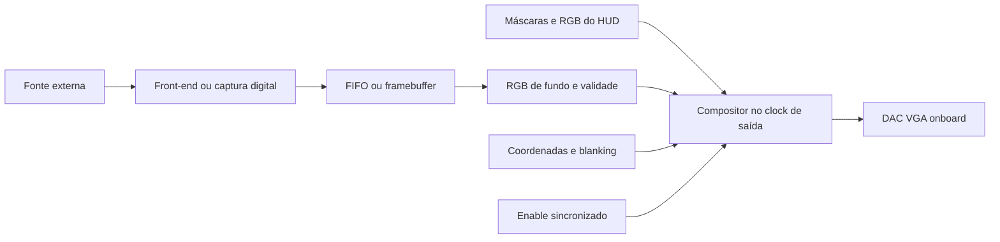

# VGA auxiliar e vídeo de fundo

**Estudo de arquitetura, não implementado. PENDENTE DE VALIDAÇÃO FÍSICA.**
O projeto hoje gera VGA; não captura vídeo. Nenhuma porta ou constraint foi
acrescentada para esta proposta. O HUD acadêmico atual continua procedural, sem
framebuffer externo; a captura com memória seria uma expansão de escopo posterior.

A recomendação é começar pela **opção B, com fonte digital controlada e resolução
reduzida**, e validar captura/composição antes de comprar ou integrar um front-end
analógico. A opção A é necessária para aceitar RGB de uma VGA convencional.

## Controle digital não é captura

`VIDEO_AUX_ENABLE` poderá selecionar HUD puro ou HUD sobre fundo válido.
A proposta é **JA2 / D18 / LVCMOS33**, com JA3/E18 para `VIDEO_SOURCE_SELECT`.
São reservas documentais verificadas no [mapa de pinagem](pinagem.md), sem ligação
nova no XDC. O botão do joystick já ocupa JA1/C17. Um enable assíncrono exige
sincronizador, nível definido e, se mecânico, debounce; aplicar a seleção no limite
do quadro evita mudança visível no meio da imagem.

Esse fio transporta um comando lógico. **Não transporta nem digitaliza RGB VGA.**
RGB VGA é analógico; nunca ligar R/G/B externos diretamente a GPIO LVCMOS33.
O DE-15 da Nexys A7 é saída por DAC resistivo, não entrada bidirecional.

## Alternativas

| Opção | Caminho | Vantagem | Custo e dificuldade |
| --- | --- | --- | --- |
| A: captura VGA analógica | RGB → front-end ADC de vídeo → pixels digitais → FPGA | Aceita fonte VGA convencional compatível | Placa externa, recuperação de clock, condicionamento, barramento e possível framebuffer |
| B: fonte digital | RGB digital + PCLK + sincronismos → FPGA | Contrato controlável; melhor primeira etapa acadêmica | Exige fonte compatível, integridade de sinal, captura e CDC |
| C: overlay analógico | VGA externa + RGB do HUD → chave/compositor externo → monitor | Dispensa digitalizar e armazenar o fundo | Exige genlock, máscara alinhada e circuito analógico de vídeo; menor flexibilidade |

### A. Captura VGA analógica real

O hardware externo precisa de terminação adequada, proteção, condicionamento de
nível, clamp/ajuste de ganho e ADCs de vídeo para os três canais. Alternativamente,
um conversor VGA para um barramento digital documentado pode reunir essas funções.
É preciso confirmar resolução, formato, níveis elétricos, latência e disponibilidade
de PCLK/HSYNC/VSYNC/DE; saída HDMI de um conversor não equivale a RGB paralelo PMOD.

HSYNC/VSYNC também precisam de compatibilidade elétrica. A entrada VGA não fornece
um pixel clock separado: o front-end normalmente recupera/sintetiza amostragem a
partir dos sincronismos e do modo conhecido. HSYNC sozinho não especifica todas
as posições e fases de amostragem dos pixels.

Para 640×480 próximo de 60 Hz, a cadeia deve amostrar cada cor na ordem de
25 milhões de pixels/s. O XADC onboard, com conversão na ordem de 1 MSPS, não
substitui três ADCs de vídeo. Nem seus canais ocupados pelo joystick devem ser
tratados como entrada VGA. O manual descreve o DAC VGA e o JXADC nas seções 8 e 10.
[Manual oficial da Nexys A7](https://digilent.com/reference/_media/reference/programmable-logic/nexys-a7/nexys-a7_rm.pdf).

Não há modelo comercial selecionado nem captura comprovada. A escolha do front-end
precisa anteceder a pinagem final; muitos dispositivos usam tensões diferentes de
3,3 V e exigem tradução de nível adequada à frequência.

### B. Fonte digital simplificada

Contrato inicial sugerido: RGB332 ou RGB444 paralelo, PCLK, HSYNC, VSYNC e DE
(pixel ativo), resolução fixa e polaridades documentadas. Contagem com esses quatro
sinais auxiliares, sem incluir terra, alimentação ou comandos:

| Formato | Dados | Total de sinais | Viabilidade de pinos no estado atual |
| --- | ---: | ---: | --- |
| RGB332 | 8 | 12 | Cabe em JB+JC, sobrando quatro posições |
| RGB444 | 12 | 16 | Ocupa todos os sinais de JB+JC |
| RGB565 | 16 | 20 | Precisa de outro conector além de JB+JC |
| RGB888 | 24 | 28 | Excede os 25 GPIOs digitais livres antes das reservas de controle |

JB3/G16 é candidato a PCLK, por ser MRCC no Master XDC. Reservar JA para comandos
mantém JB/JC contínuos para captura. A distribuição exata dos dados depende do
front-end e do planejamento de clock; não foi atribuída no XDC.

25/25,175 MHz é uma **meta a caracterizar**, não frequência máxima garantida do
PMOD. Cabos, retornos de terra, carga, skew e resistores série de 200 Ω afetam as
margens. Usar interconexão curta, conferir bancos/tensões e impor input delays a
partir de dados da fonte e medição. O manual não especifica PMOD como interface
com impedância e comprimentos casados; o [esquemático D.0](https://digilent.com/reference/_media/reference/programmable-logic/nexys-a7/nexys-a7-sch.pdf)
mostra a rede série. Não aprovar captura apenas porque a síntese aceitou os pinos.

Uma fonte de padrões controlada permite iniciar abaixo dessa taxa e testar
320×240 RGB332, com ampliação 2× para a saída 640×480. Isso é um novo protocolo
acordado com a fonte; não significa que uma VGA arbitrária possa ser conectada
com resolução reduzida sem captura e reamostragem.

### C. Overlay analógico após a FPGA

Um circuito externo selecionaria RGB de fundo ou RGB do DAC do HUD a partir de
uma máscara de keying. Seriam necessários switches/muxes e buffers apropriados
para vídeo, terminação, níveis e largura de banda. Não presumir que um mux lógico
ou analógico genérico mantenha qualidade e amplitude no monitor.

O HUD precisa estar sincronizado à mesma imagem externa: sincronismos, pixel clock
e máscara devem ter fase e latência alinhadas. Genlock ou recuperação de clock
continua necessário; dois geradores VGA independentes não produzem overlay estável.
A máscara deve distinguir pixels transparentes e preservar cores do HUD. A saída
não pode ligar diretamente duas fontes analógicas entre si.

Essa opção evita framebuffer do fundo e pode ter baixa latência, mas acrescenta
um projeto analógico e limita processamento/escala da imagem. Só vale escolhê-la
se houver front-end e meios de medir sincronismo e qualidade analógica.

## Composição futura



Interface conceitual, sem implementação nesta branch:

```systemverilog
if (!video_on)
    rgb = BLACK;
else if (hud_pixel_on)
    rgb = hud_rgb;
else if (video_aux_enable && video_aux_valid)
    rgb = video_background_rgb;
else
    rgb = BLACK;
```

`hud_pixel_on` deve ser a união das máscaras visíveis no modo escolhido, com
prioridades de cor explícitas. Usar `hud_rgb` preserva alvo/status vermelhos e
simbologia verde. Fundo preto não deve ser usado implicitamente como máscara
sem definir transparência. RGB, máscaras, coordenadas e sincronismos precisam
receber atrasos equivalentes no pipeline.

## Clock, CDC e perda de sincronismo

O vídeo externo e os 25 MHz internos podem ser independentes. Mesmo uma fonte
nominalmente igual deriva com tolerância de osciladores. O modo interno atual,
25 MHz/800/525 ≈59,52 Hz, difere de 25,175 MHz/800/525 ≈59,94 Hz.
Uma FIFO pequena absorve fase e rajadas, mas não uma diferença contínua de taxa.

- **Genlock:** gerar a saída com clock/timing compatível com a fonte reduz o
  problema de taxa. Exige modo externo suportado, recuperação de clock confiável
  e estratégia segura quando ele desaparecer; não usar mux combinacional de clocks.
- **FIFO assíncrona:** transferir pixels e marcadores de linha/quadro com ponteiros
  sincronizados. Não sincronizar cada bit RGB com dois flip-flops independentes.
  Detectar overflow/underflow e descartar um quadro incompleto com fronteira definida.
- **Framebuffer:** escrita no domínio de entrada e leitura no domínio de saída.
  Trocar propriedade dos buffers por handshake no blanking; se taxas divergirem,
  repetir ou descartar quadros inteiros. Buffer único pode causar tearing.
- **Perda de sincronismo:** contar largura/altura, períodos e timeout; invalidar o
  fundo e manter HUD puro. Reaceitar vídeo após quadro completo consistente.
  A latência da captura/memória precisa ser medida e documentada.

Genlock com buffers de linha pode reduzir latência para fontes controladas.
Double buffering simplifica a independência entre clocks, ao custo de memória e
latência da ordem de um quadro ou mais conforme a política de troca.

## Memória e largura de banda

Cálculos de capacidade abaixo consideram apenas pixels ativos, sem overhead:

| Imagem/formato | Um quadro | Dois quadros |
| --- | ---: | ---: |
| 640×480 RGB332 | 300 KiB | 600 KiB |
| 640×480 RGB444 | 450 KiB | 900 KiB |
| 640×480 RGB565 | 600 KiB | 1200 KiB |
| 640×480 RGB888 | 900 KiB | 1800 KiB |
| 320×240 RGB332 | 75 KiB | 150 KiB |
| 160×120 RGB332 | 18,75 KiB | 37,5 KiB |

O dispositivo disponibiliza 135 blocos de 36 Kib no [relatório de recursos](../bitstreams/2026-10-05_hmc5883l/utilization.rpt):
607,5 KiB brutos contando bits de paridade. A configuração das portas, o packing
e as FIFOs reduzem a capacidade utilizável. RGB444 de quadro inteiro exige packing
para caber; a alocação ingênua em palavras de 18 bits pode ultrapassar 135 blocos.
Double buffering 640×480 RGB332 parece caber pela soma bruta, mas não deve ser
prometido: mapeamento usual de 8 bits em portas de 9 bits já excede a capacidade.
320×240 RGB332 duplo é uma meta inicial com folga, sujeita à síntese do controlador.

DDR2 onboard de 128 MiB oferece capacidade para quadros completos, mas exige
controlador/MIG, clocks, reset, arbitragem, bursts e FIFOs. Não existe controlador
DDR no HUD atual. Para RGB444 640×480 a 60 quadros/s, pixels ativos consomem
27,648 MB/s em cada sentido, ou 55,296 MB/s de escrita+leitura, antes de padding
e overhead. Dimensionar largura de banda efetiva, não apenas tamanho da memória.

## Etapas e critérios de aceitação

1. Definir formato, resolução, clock, polaridades, máscara e fallback. Simular
   compositor com padrões internos e comparar todos os pixels/modos.
2. Capturar fonte digital controlada em resolução reduzida; testar CDC com fases
   e taxas diferentes, quadros incompletos, perdas e retorno da fonte.
3. Validar pinos/constraints, temporização e sinais na bancada. Medir latência,
   tearing e comportamento do enable antes de considerar a etapa concluída.
4. Só então escolher ADC/conversor VGA e decidir genlock, BRAM ou DDR2 para a
   resolução final. Reexecutar regressão e implementação com timing fechado.

Não há garantia de compatibilidade com qualquer resolução VGA, HDMI ou câmera.
A primeira versão deve aceitar um modo explicitamente acordado e rejeitar os demais.
