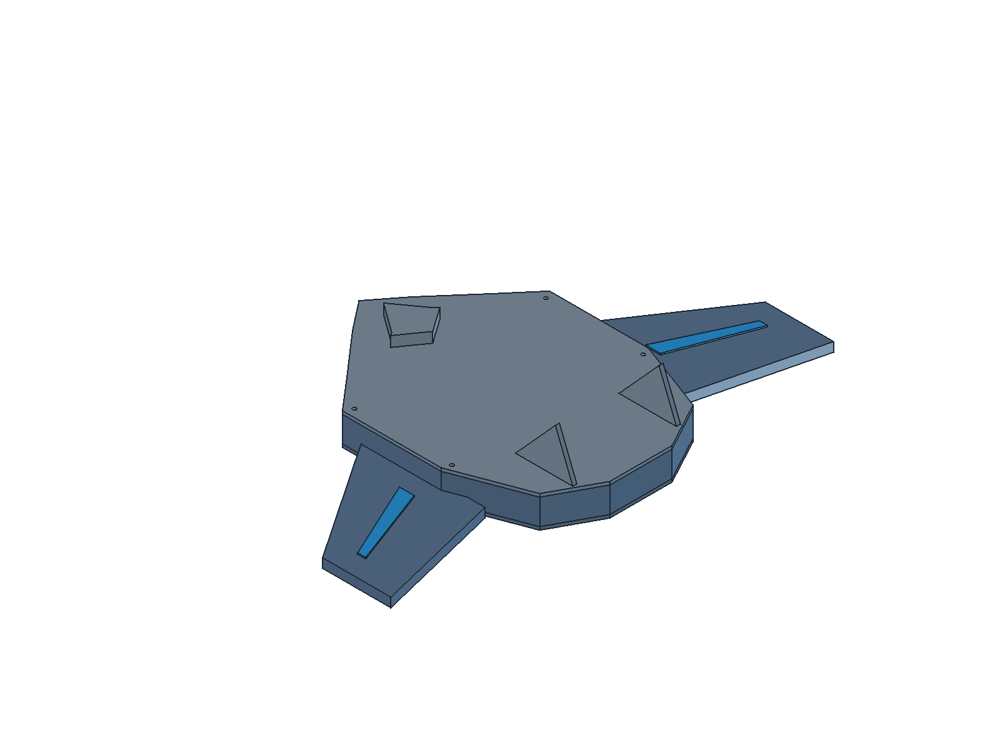
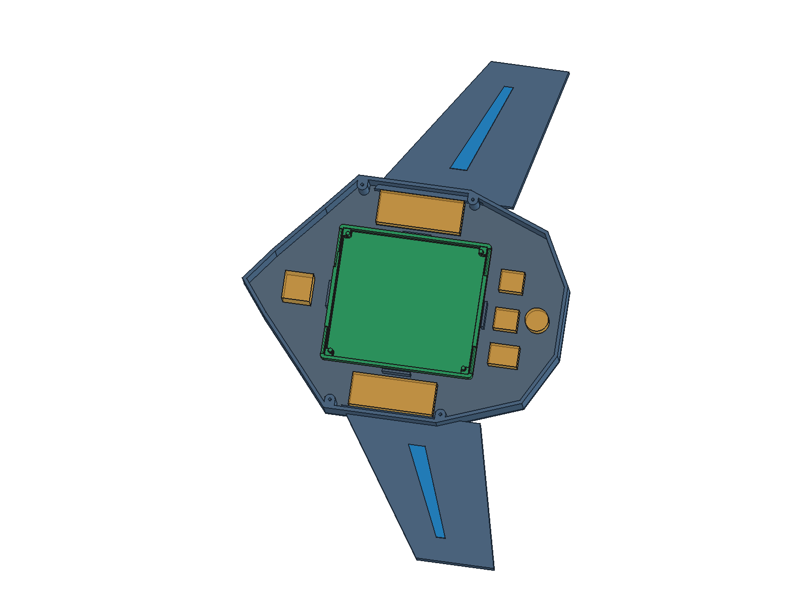

# HUD FPGA Stealth — mecânica V3

Engenharia mecânica preliminar: fuselagem oca, base e tampa removíveis, asas delta, cockpit e duas derivas. Ainda depende de medidas físicas e recortes das interfaces; não liberado para impressão final.

- [Abrir documentação e pendências](LEIA_ME_PENDENCIAS.md)
- [Baixar o projeto FreeCAD editável](HUD_FPGA_Stealth_V3.FCStd)
- [Macro de geração](Gerar_HUD_FPGA_Stealth_V3.FCMacro)
- [STEP e STL preliminares](exportacoes_PRELIMINARES)

## Como continuar

1. Baixe o repositório e abra o FCStd no FreeCAD.
2. Salve suas alterações no FCStd; mantenha os originais em `referencias` preservados.
3. Para alterar dimensões pela macro, edite seus parâmetros e gere em uma cópia da pasta: ela sobrescreve os arquivos V3 dessa pasta.
4. Atualize a documentação e exportações após conferir a geometria. Registre cada avanço em um commit.

O FCStd contém sólidos editáveis, sem árvore completa de sketches cotados. Os parâmetros informativos no documento não regeneram as peças; a macro é a fonte para geração reproduzível. As duas protoboards são iguais conforme informado pelo usuário, mas suas medidas ainda são estimativas.

